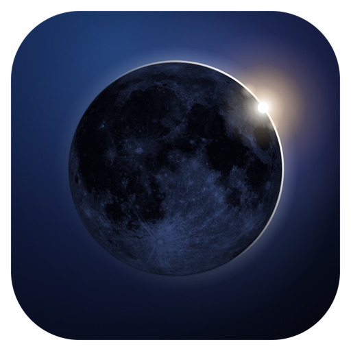
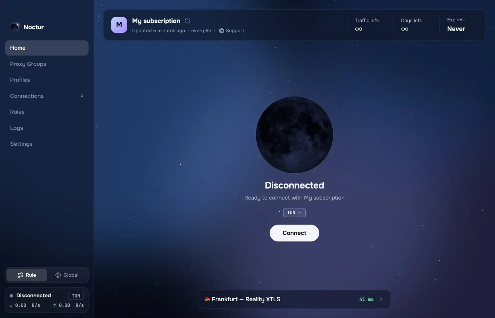
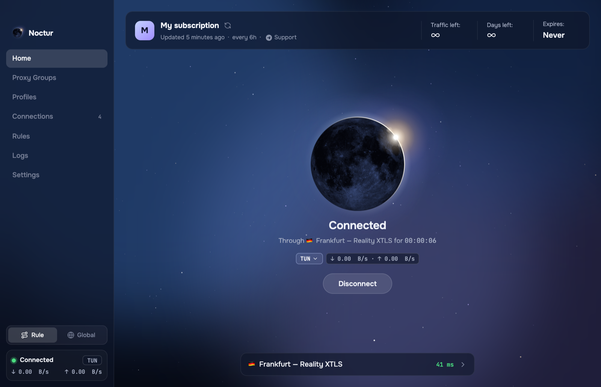
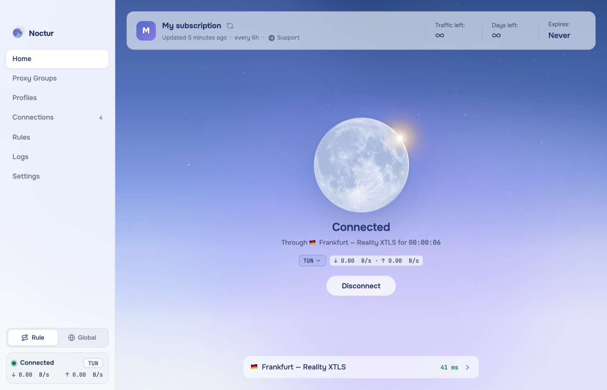
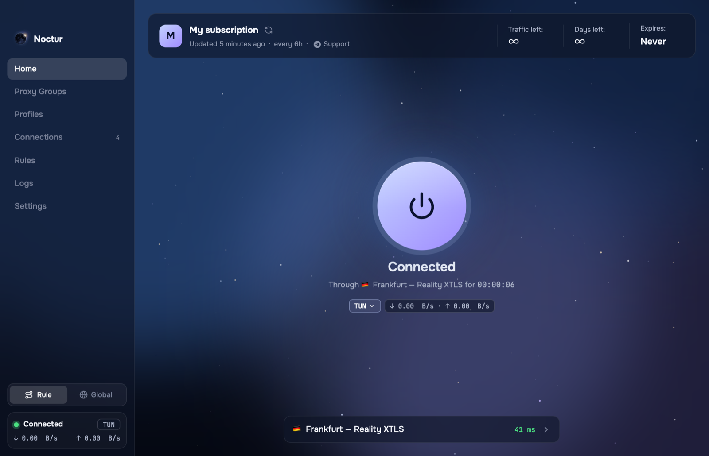
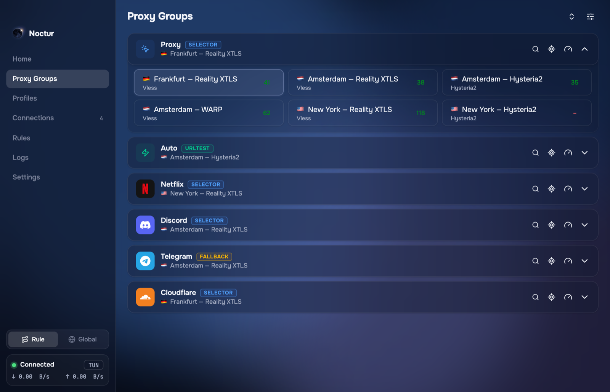
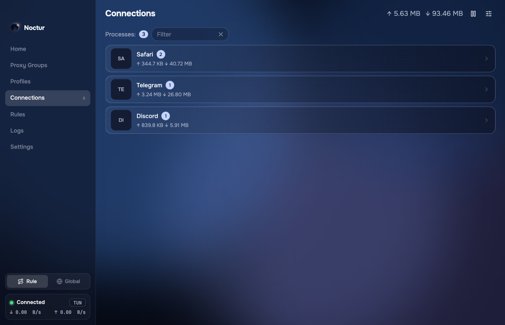
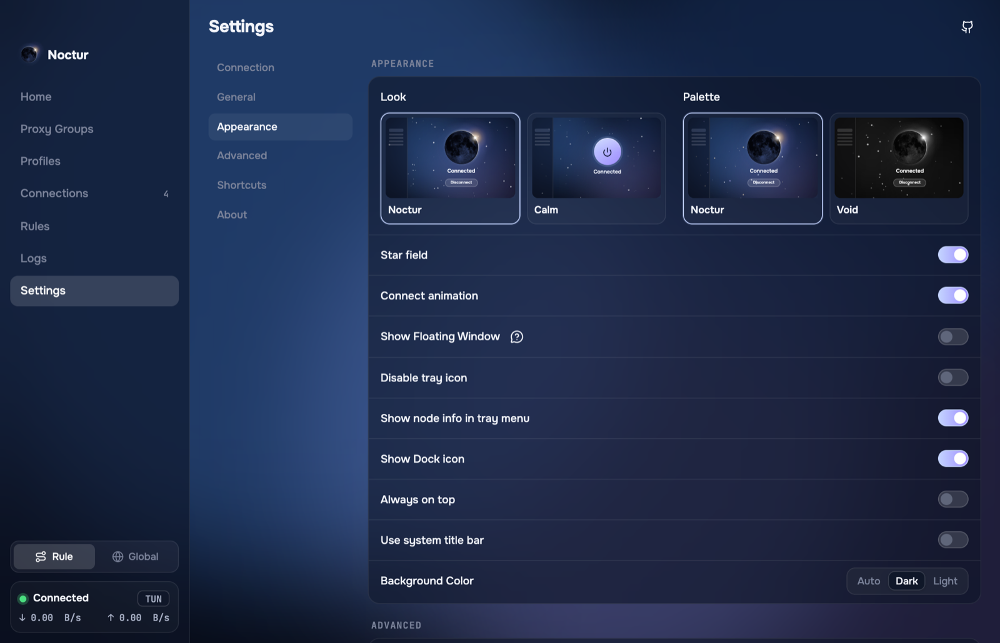

<p align="center">
  
</p>

<h1 align="center">Noctur</h1>

<p align="center"><a href="https://github.com/MetaCubeX/mihomo">mihomo</a> client for macOS, Windows and Linux</p>

<p align="center">
  <a href="https://github.com/Derpcrawler/noctur/releases/latest"></a>
  <a href="./LICENSE"></a>
</p>

<p align="center"></p>

## Features

- Modern and simple design
- Two looks: Noctur, with an eclipse that lights up when you connect, and Calm, with a simple power switch
- TUN mode and system proxy, switched from Home
- Subscription details: traffic and days left, update interval, support link (Remnawave and similar panels)
- Proxy groups with latency tests, rules, live connections, logs
- TUN, DNS and sniffer settings, plus a profile editor with validation
- Profile import from `clash://` links
- Stable and alpha mihomo cores
- Updates from Home in one click when a new version is out (macOS and Windows)
- Menu bar and tray menu, global shortcuts, floating speed window
- Two palettes, Noctur and Void, and a light mode
- English, Russian, Chinese

## Download

Get the latest version from [Releases](https://github.com/Derpcrawler/noctur/releases/latest).

| System | File |
|---|---|
| macOS 13 or later, Apple Silicon | `Noctur_<version>_arm64.pkg` |
| Windows 10 or 11, x64 | `Noctur_<version>_x64-setup.exe` |
| Debian, Ubuntu and derivatives, x64 | `Noctur_<version>_amd64.deb` |
| Fedora, openSUSE, x64 | `Noctur_<version>_x86_64.rpm` |
| Arch and derivatives, x64 | `Noctur_<version>_x64.pkg.tar.xz` |

### First launch

The builds are not signed with an Apple or Microsoft certificate, so macOS and Windows ask for confirmation once:

- **macOS:** open System Settings, Privacy & Security, click Open Anyway next to the message about the installer, and run it again.
- **Windows:** in the "Windows protected your PC" message, click More info, then Run anyway.
- **Linux:** install the package with your package manager, for example `sudo apt install ./Noctur_<version>_amd64.deb`.

Coming from Astra Clash? Install Noctur over it: your settings, profiles and autostart move over on first start.

Found a bug? [Open an issue](https://github.com/Derpcrawler/noctur/issues).

## Build from source

You need Node.js 22.12 or later, pnpm 10 and Git. Building for Windows also needs Go 1.21 or later.

```bash
git clone https://github.com/Derpcrawler/noctur.git
cd noctur
pnpm install   # also downloads mihomo, geo data and helpers for this system
pnpm dev
```

Packages, built on the system you are packaging for:

```bash
pnpm build:mac --arm64      # .pkg
pnpm build:win --x64        # .exe installer
pnpm build:linux --x64      # .deb, .rpm and .pkg.tar.xz
pnpm build:linux deb --x64  # one format only: deb, rpm or pacman
```

Packages land in `dist/`.

| Command | What it does |
|---|---|
| `pnpm dev` | Start the app with hot reload for the interface (restart for main process changes) |
| `pnpm test` | Run the tests |
| `pnpm typecheck` | Check types |
| `pnpm lint` | Run ESLint |

<details>
<summary>Building for another system</summary>

`pnpm install` downloads the core and helpers for the system you're on. To package for another one, fetch its binaries first; this replaces the current ones, so run it again for your own system afterwards.

```bash
node scripts/prepare.mjs --x64 --win     # then pnpm build:win --x64
node scripts/prepare.mjs --x64 --linux   # then pnpm build:linux --x64
node scripts/prepare.mjs --arm64 --mac   # back to macOS binaries
```

Linux packages built on macOS need `rpmbuild` (`brew install rpm`) and GNU `ar` first on your PATH (`brew install binutils`, then add `$(brew --prefix binutils)/bin`). With the macOS `ar`, the .deb comes out empty.

</details>

## Screenshots

| | |
|---|---|
|  |  |
|  |  |
|  |  |

## Credits

Based on [Koala Clash](https://github.com/coolcoala/koala-clash) by coolcoala, which builds on [Sparkle](https://github.com/xishang0128/sparkle) and [Mihomo Party](https://github.com/mihomo-party-org/mihomo-party). The proxy core is [mihomo](https://github.com/MetaCubeX/mihomo).

## License

GPL-3.0. See [LICENSE](./LICENSE).
